<h1 align="center">Claude Code HitMap</h1>

<p align="center">
  Claude Code로 일한 날을 GitHub 잔디처럼.<br>
  내 Mac의 Claude Code 기록에서 하루치 토큰을 세어, README에 바로 넣을 수 있는 SVG로 그립니다.
</p>

<p align="center">
  
  = 18.17">
  
  
  <a href="LICENSE"></a>
</p>

<p align="center">
  
</p>

## 왜 만들었나

GitHub 잔디는 커밋만 셉니다. 요즘 제 하루는 Claude Code와 함께 일하는 시간이 더 긴데, 그 기록을 보여줄 방법이 없었습니다. 게다가 Claude Code는 **대화 기록을 30일이 지나면 지웁니다.** 오늘 세지 않으면 다음 달엔 사라집니다.

| | |
|---|---|
| ✅ **하는 일** | 내 컴퓨터의 Claude Code 기록에서 날짜별 토큰을 세고, 지워지기 전에 장부 파일(`claude-hitmap.json`)에 쌓고, 잔디 SVG를 그리고, 원하면 git push까지 합니다. |
| 🚫 **하지 않는 일** | 서버를 띄우지 않고, 어디에도 데이터를 보내지 않습니다. 프롬프트·코드·프로젝트 이름은 읽지도 저장하지도 않습니다. |

> **URL만으로 되는 방식이 아닌 이유** — github-readme-stats처럼 `?user=` 하나로 그려주면 좋겠지만, Claude Code 토큰 기록은 Anthropic 서버가 아니라 **내 컴퓨터의 `~/.claude` 안에만** 있습니다. 그래서 내 컴퓨터에서 한 번 실행해 SVG를 내 저장소에 올리고, README는 그 파일을 가리키게 합니다.

## 빠른 시작

```bash
# 1. 설치 (Node 18.17+)
npm install -g github:amuldi/ClaudeCode_HitMap

# 2. README를 둘 저장소에서 실행 — 예: 프로필 저장소 <you>/<you>
cd ~/code/<you>
cc-hitmap --push
```

`claude-hitmap.svg`와 `claude-hitmap.json`이 생기고, `--push`가 커밋·푸시까지 합니다.

### 3. README에 넣기

```markdown

```

SVG가 보는 사람의 라이트/다크 모드를 스스로 따라가므로 `<picture>` 태그가 필요 없습니다.

## 자동으로 갱신하기

Claude Code 세션이 끝날 때마다 갱신하려면 `~/.claude/settings.json`에 훅을 추가합니다.

```json
{
  "hooks": {
    "SessionEnd": [
      {
        "hooks": [
          { "type": "command", "command": "cc-hitmap --out ~/code/<you> --push >/dev/null 2>&1 &" }
        ]
      }
    ]
  }
}
```

끝에 `&`를 붙여 뒤에서 돌게 하면 세션 종료가 기다리지 않습니다. 하루 한 번이면 충분하다면 cron도 됩니다.

```cron
0 23 * * *  cc-hitmap --out ~/code/<you> --push
```

## 옵션

| 옵션 | 기본값 | 설명 |
|---|---|---|
| `-o, --out <dir>` | `.` | 파일을 쓸 폴더 |
| `--svg <name>` | `claude-hitmap.svg` | SVG 파일 이름 |
| `--data <name>` | `claude-hitmap.json` | 장부 파일 이름 |
| `--claude-dir <dir>` | `$CLAUDE_CONFIG_DIR`, 없으면 `~/.claude`·`~/.config/claude` | Claude Code 데이터 폴더 (여러 번 지정 가능) |
| `--metric <m>` | `total` | `total` · `output` · `input` (아래 참고) |
| `--days <n>` | `365` | 보여줄 기간, 7–371일 |
| `--tz <zone>` | 이 컴퓨터의 시간대 | 하루를 자르는 기준 (예: `Asia/Seoul`) |
| `--theme <t>` | `auto` | `auto`(보는 사람 설정을 따름) · `light` · `dark` |
| `--lang <l>` | `en` | `en` · `ko` |
| `--title <text>` | `Claude Code` | 제목 |
| `--prompts` | | `history.jsonl`로 **프롬프트 수 잔디**(`claude-prompts.svg`)와 **프로젝트별 막대**(`claude-projects.svg`)도 그리기. 토큰 기록보다 훨씬 오래 남아 있어요 |
| `--years` | | 달력 연도별 잔디도 그리기. 1월 1일부터 12월 31일(올해는 오늘)까지, `claude-hitmap-<연도>.svg` (`--prompts`와 같이 쓰면 `claude-prompts-<연도>.svg`도) |
| `--top <n>` | `8` | 프로젝트 막대에 보일 개수 (1–30) |
| `--no-mascot` | | 픽셀 마스코트 빼기 |
| `--full` | | 마지막 실행 이후 바뀐 기록만이 아니라 전부 다시 읽기 |
| `--push` | | 두 파일을 `git add` · `commit` · `push` |

## 어떻게 세나요

- **어디서** — `~/.claude/projects/**/*.jsonl` (Claude Code의 세션 기록)의 assistant 응답마다 붙은 `usage`.
- **중복 제거** — 스트리밍 중 같은 응답이 여러 줄로 기록되므로 `message.id` + `requestId`로 한 번만 셉니다. 같은 응답의 여러 줄 중 가장 큰 값을 씁니다.
- **지표**
  - `total` = 입력 + 출력 + 캐시 쓰기 + 캐시 읽기 (Claude Code가 실제로 처리한 전체 토큰)
  - `output` = 출력 토큰 (thinking 포함)
  - `input` = 새 입력 + 캐시 쓰기
- **하루의 경계** — `--tz` 시간대의 자정. 장부는 만든 시간대로 고정되어, 다른 시간대로 실행하면 섞이지 않게 멈춥니다.
- **색 단계** — GitHub처럼, 활동한 날들의 사분위수로 5단계를 나눕니다. 유난히 많이 쓴 하루가 나머지를 다 옅게 만들지 않습니다.
- **기록 보존** — 장부는 날짜·항목별로 **더 큰 값만 남깁니다.** Claude Code가 오래된 기록을 지운 뒤 다시 세어도 히스토리는 줄지 않습니다.
- **빠른 재실행** — 마지막 실행 하루 전 이후 수정된 기록 파일만 읽고, 그 날짜 이후의 값만 반영합니다. 그 전 날짜는 건드리지 않습니다. (`--full`로 전부 다시 셀 수 있습니다.)

## 개인정보

장부 파일에는 날짜별 숫자 다섯 개(입력·출력·캐시 쓰기·캐시 읽기·응답 수)만 들어갑니다. 프롬프트, 코드, 파일 경로, 프로젝트 이름은 저장하지 않습니다. 실제 예: [`docs/claude-hitmap.json`](docs/claude-hitmap.json).

## 한계

- 설치하기 전 30일보다 오래된 기록은 이미 Claude Code가 지웠기 때문에 되살릴 수 없습니다. **오늘부터 쌓입니다.**
- 컴퓨터가 여러 대라면 각자 다른 장부를 만듭니다. 합치는 기능은 아직 없습니다.
- claude.ai 웹·앱 대화는 포함하지 않습니다.

## 라이브러리로 쓰기

```ts
import { collect, defaultClaudeDirs, renderSvg, metricValue } from 'claude-code-hitmap';

const { days } = await collect({ dirs: defaultClaudeDirs(), timeZone: 'Asia/Seoul' });
const values = new Map([...days].map(([d, c]) => [d, metricValue(c, 'output')]));
const svg = renderSvg(values, { end: '2026-11-06', theme: 'dark' });
```

## 개발

```bash
npm ci
npm test          # 빌드 후 node:test 실행
npm run typecheck
```

```
src/
  collect.ts   기록 파일 찾기 · 한 줄 파싱 · 중복 제거 · 날짜별 합산
  ledger.ts    장부 읽기 · 검증 · 병합(큰 값 유지) · 저장
  calendar.ts  일요일 시작 주 단위 격자 · 사분위 단계 · 연속 기록
  render.ts    잔디·프로젝트 막대 SVG 생성 (라이트/다크 자동, en/ko)
  history.ts   history.jsonl에서 날짜별·프로젝트별 프롬프트 수 세기
  mascot.ts    픽셀 마스코트
  run.ts       CLI 인자 처리와 실행 흐름
  cli.ts       실행 파일 진입점
test/          node:test, 가짜 기록 파일(fixtures)로 실제 흐름까지 검사
```

- 실행 의존성 0개. 개발 의존성은 `typescript`와 `@types/node`뿐입니다.
- TypeScript `strict` + `noUncheckedIndexedAccess` + `exactOptionalPropertyTypes`.
- CI는 Node 18 · 20 · 22에서 타입 검사, 테스트, 실제 CLI 실행까지 확인합니다.

---

Claude Code 사용자가 만든 비공식 도구이며 Anthropic과 관련이 없습니다. Claude는 Anthropic의 상표입니다.

[MIT](LICENSE) © Sihun Jeon
