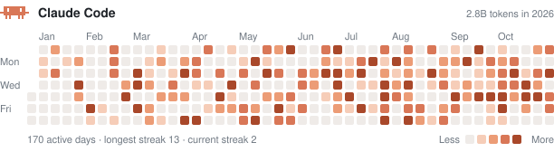
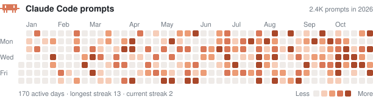
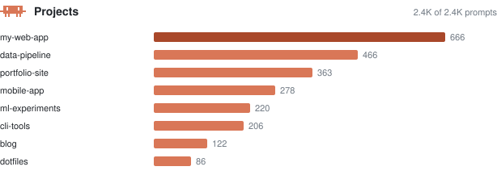
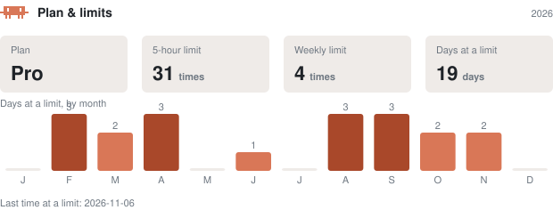
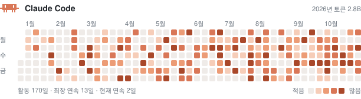
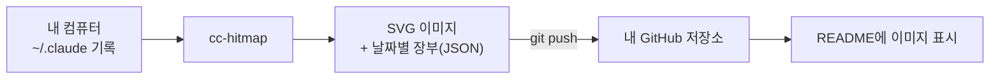

<div align="center">

# 🟧 Claude Code Activity

**내 Claude Code 사용량을 GitHub 잔디처럼, 프로필 README에.**

내 컴퓨터의 Claude Code 기록에서 토큰 · 프롬프트 · 프로젝트 · 사용 한도를 세어<br>
README에 바로 넣을 수 있는 SVG 이미지로 그려 주는 CLI 도구 `cc-hitmap`과 사용 가이드입니다.

<br>


= 18.17">


<a href="LICENSE"></a>

<br><br>



<sub>↑ 예시 데이터로 만든 이미지입니다 · 실제 사용 모습: <a href="https://github.com/amuldi/Hello-World">amuldi/Hello-World</a></sub>

<br>

[**사용한 기술**](#-사용한-기술) · [**어떻게 나오나**](#-어떻게-나오나) · [**빠른 시작**](#-빠른-시작) · [**자동 갱신**](#-자동-갱신) · [**옵션**](#%EF%B8%8F-옵션) · [**어떻게 세나요**](#-어떻게-세나요) · [**FAQ**](#-faq) · [**개발**](#%EF%B8%8F-개발)

</div>

<br>

## 🧰 사용한 기술

<p>


</p>

| | |
|---|---|
| ✅ **하는 일** | 내 컴퓨터의 Claude Code 기록에서 날짜별 토큰·프롬프트를 세고, 지워지기 전에 장부 파일(`claude-hitmap.json`)에 쌓고, 잔디 SVG를 그리고, 원하면 git push까지 합니다. |
| 🚫 **하지 않는 일** | 서버를 띄우지 않고, 어디에도 데이터를 보내지 않습니다. 프롬프트·코드는 읽지도 저장하지도 않습니다. |

> [!NOTE]
> 이 저장소의 `examples/` 이미지는 **예시용 가짜 데이터**입니다. 각자 자기 컴퓨터에서 실행해 **자기 저장소**에 올리면 됩니다.

## 💡 왜 만들었나

GitHub 잔디는 커밋만 셉니다. 요즘 제 하루는 Claude Code와 함께 일하는 시간이 더 긴데, 그 기록을 보여줄 방법이 없었습니다. 게다가 Claude Code는 **대화 기록을 30일이 지나면 지웁니다.** 오늘 세지 않으면 다음 달엔 사라집니다.

URL 하나로 그려주는 방식(github-readme-stats 같은)이 안 되는 이유도 같습니다. Claude Code 사용 기록은 Anthropic 서버가 아니라 **내 컴퓨터의 `~/.claude` 안에만** 있습니다. 그래서 내 컴퓨터에서 한 번 실행해 SVG를 내 저장소에 올리고, README는 그 파일을 가리키게 합니다.

## ✨ 어떻게 나오나

<table>
<tr>
<td width="50%" valign="top">

### 🟧 토큰 잔디
하루에 Claude Code가 처리한 토큰 (입력·출력·캐시 포함). 진할수록 많이 쓴 날이에요.

</td>
<td width="50%" valign="top">

### 🟧 프롬프트 잔디
하루에 Claude Code에 보낸 프롬프트 수. 과거 몇 달치도 바로 채워져요.

</td>
</tr>
</table>



### 📊 프로젝트 막대

가장 많이 작업한 프로젝트 폴더 순서예요.



### ⚡ 플랜 · 한도

내 **플랜**과, 5시간·주간 **사용 한도에 얼마나 자주 닿았는지**를 월별 막대로 보여 줘요.



<sub>한도의 몇 %를 썼는지는 서버에만 있어서 알 수 없어요. 한도에 닿은 횟수와 날만 보여 줍니다.</sub>

### 🎨 그 밖에

- **연도별**로 따로 만들어져요 (`2026`, `2027`, …)
- 보는 사람의 **라이트/다크 모드를 자동으로** 따라가요 (`<picture>` 태그 필요 없음)
- 한글 표기도 돼요 (`--lang ko`)



## 🚀 빠른 시작

**준비물:** Node 18.17 이상 · git · Claude Code를 써 본 컴퓨터 · 이미지를 올릴 GitHub 저장소 (프로필 저장소 `<내아이디>/<내아이디>`가 가장 간단해요)



### 1️⃣ 설치

```bash
npm install -g github:amuldi/MyClaudeCode_Activity
```

### 2️⃣ 내 저장소에서 실행

```bash
git clone https://github.com/<내아이디>/<내아이디>
cd <내아이디>
cc-hitmap --out claude-activity --prompts --years --limits --push
```

실행하면 이런 결과가 나와요.

```text
History: 2407 prompts on 170 days, 8 projects.
Years: 2026
Scanned 20 transcripts.
Ledger: 170 days (.../claude-activity/claude-hitmap.json)
Last 365 days: 2.8B total tokens · 170 active days · longest streak 13
Pushed.
```

`claude-activity/` 폴더에 파일이 만들어지고, `--push`가 커밋·푸시까지 해 줘요.

| 파일 | 내용 |
|---|---|
| `claude-hitmap-2026.svg` | 2026년 토큰 잔디 |
| `claude-prompts-2026.svg` | 2026년 프롬프트 잔디 |
| `claude-limits-2026.svg` | 2026년 플랜 · 한도 도달 현황 |
| `claude-projects.svg` | 프로젝트별 막대 |
| `claude-hitmap.json` | 날짜별 숫자 장부 — **지우지 마세요** |

새 해가 되면 `claude-hitmap-2027.svg`처럼 그 해 파일이 자동으로 생겨요.

### 3️⃣ README에 넣기

저장소 안의 파일이라 **상대 경로**로 넣으면 돼요.

````markdown
## 🤖 Claude Code Activity


````

가운데 정렬은 HTML로 감싸요.

```html
<div align="center">
  
</div>
```

여러 해를 접었다 펼 수 있게 하려면:

````markdown
<details>
<summary><b>2026</b></summary>


</details>
````

## 🔄 자동 갱신

새 활동을 반영하려면 **같은 명령을 다시 실행**하면 돼요.

세션이 끝날 때마다 자동으로 하려면 `~/.claude/settings.json`에 훅을 추가하세요. 끝에 `&`를 붙여 뒤에서 돌게 하면 세션 종료가 기다리지 않아요.

```json
{
  "hooks": {
    "SessionEnd": [
      {
        "hooks": [
          { "type": "command", "command": "cd ~/code/<내아이디> && cc-hitmap --out claude-activity --prompts --years --limits --push >/dev/null 2>&1 &" }
        ]
      }
    ]
  }
}
```

하루에 한 번이면 충분하다면 cron도 돼요.

```cron
0 23 * * *  cd ~/code/<내아이디> && cc-hitmap --out claude-activity --prompts --years --limits --push
```

## ⚙️ 옵션

| 옵션 | 기본값 | 설명 |
|---|---|---|
| `-o, --out <dir>` | `.` | 파일을 쓸 폴더 |
| `--svg <name>` | `claude-hitmap.svg` | SVG 파일 이름 |
| `--data <name>` | `claude-hitmap.json` | 장부 파일 이름 |
| `--claude-dir <dir>` | `$CLAUDE_CONFIG_DIR`, 없으면 `~/.claude`·`~/.config/claude` | Claude Code 데이터 폴더 (여러 번 지정 가능) |
| `--metric <m>` | `total` | `total` · `output` · `input` (아래 참고) |
| `--days <n>` | `365` | 보여줄 기간, 7–371일 |
| `--tz <zone>` | 이 컴퓨터의 시간대 | 하루를 자르는 기준 (예: `Asia/Seoul`) |
| `--theme <t>` | `auto` | `auto`(보는 사람 설정을 따름) · `light` · `dark` |
| `--lang <l>` | `en` | `en` · `ko` |
| `--title <text>` | `Claude Code` | 제목 |
| `--prompts` | | **프롬프트 잔디**(`claude-prompts.svg`)와 **프로젝트 막대**(`claude-projects.svg`)도 그리기. 토큰 기록보다 훨씬 오래 남아 있어요 |
| `--years` | | 최근 N일 대신 **달력 연도별** 잔디 그리기 (`claude-hitmap-<연도>.svg`) |
| `--limits` | | **내 플랜**과 **사용 한도(5시간·주간)에 닿은 횟수**를 월별 막대로 그리기 (`claude-limits.svg`) |
| `--plan <이름>` | 자동 감지 | 플랜 표기를 직접 지정 (예: `"Max 5x"`) |
| `--top <n>` | `8` | 프로젝트 막대에 보일 개수 (1–30) |
| `--no-mascot` | | 픽셀 마스코트 빼기 |
| `--full` | | 마지막 실행 이후 바뀐 기록만이 아니라 전부 다시 읽기 |
| `--push` | | 만든 파일을 `git add` · `commit` · `push` |

## 🔍 어떻게 세나요

- **어디서** — `~/.claude/projects/**/*.jsonl` (Claude Code의 세션 기록)의 assistant 응답마다 붙은 `usage`.
- **중복 제거** — 스트리밍 중 같은 응답이 여러 줄로 기록되므로 `message.id` + `requestId`로 한 번만 셉니다.
- **지표**
  - `total` = 입력 + 출력 + 캐시 쓰기 + 캐시 읽기 (Claude Code가 실제로 처리한 전체 토큰)
  - `output` = 출력 토큰 (thinking 포함)
  - `input` = 새 입력 + 캐시 쓰기
- **하루의 경계** — `--tz` 시간대의 자정. 장부는 만든 시간대로 고정되어, 다른 시간대로 실행하면 섞이지 않게 멈춥니다.
- **색 단계** — GitHub처럼, 활동한 날들의 사분위수로 5단계를 나눕니다. 유난히 많이 쓴 하루가 나머지를 다 옅게 만들지 않습니다.
- **기록 보존** — 장부는 날짜·항목별로 **더 큰 값만 남깁니다.** Claude Code가 오래된 기록을 지운 뒤 다시 세어도 히스토리는 줄지 않습니다.
- **빠른 재실행** — 마지막 실행 하루 전 이후 수정된 기록 파일만 읽습니다. (`--full`로 전부 다시 셀 수 있습니다.)
- **플랜** — Claude Code의 계정 파일(`~/.claude.json`)에서 구독 종류(Pro·Max 5x·Max 20x·Team 등)만 읽습니다.
- **한도** — 대화 기록에 남는 `You've hit your 5-hour limit` / `weekly limit` 알림을 셉니다. 같은 알림이 재시도로 여러 번 남을 수 있어 횟수는 "알림 수"에 가깝습니다.

## ❓ FAQ

<details>
<summary><b>설치하기 전 기록도 나오나요?</b></summary>

- **프롬프트 기록**은 오래 남아 있어서 과거 몇 달치가 바로 나와요.
- **토큰 기록**은 Claude Code가 대화 기록을 **30일 뒤에 지워서**, 설치 전 30일보다 오래된 날은 되살릴 수 없어요. 한 번 세어 둔 날은 장부(`claude-hitmap.json`)에 남아 사라지지 않아요.

</details>

<details>
<summary><b>개인정보는 괜찮나요?</b></summary>

저장소에는 **날짜별 숫자**, **프로젝트 폴더 이름**, **플랜 이름**(Pro·Max 등)만 올라가요. 계정 파일에서 읽는 것도 플랜 이름뿐이고 이름·이메일·ID는 읽지 않아요. 프롬프트 내용과 코드는 읽지도 올리지도 않아요. 프로젝트 이름을 공개하고 싶지 않다면 `--prompts` 없이, 플랜을 숨기고 싶다면 `--limits` 없이 실행하세요.

</details>

<details>
<summary><b>컴퓨터가 여러 대예요</b></summary>

각 컴퓨터가 별도의 장부를 만들어요. 합치는 기능은 아직 없어요.

</details>

<details>
<summary><b>claude.ai 웹·앱 대화도 포함되나요?</b></summary>

아니요. Claude Code(터미널·IDE)의 기록만 세요.

</details>

## 📦 라이브러리로 쓰기

```ts
import { collect, defaultClaudeDirs, renderSvg, metricValue } from 'claude-code-hitmap';

const { days } = await collect({ dirs: defaultClaudeDirs(), timeZone: 'Asia/Seoul' });
const values = new Map([...days].map(([d, c]) => [d, metricValue(c, 'output')]));
const svg = renderSvg(values, { end: '2026-11-06', theme: 'dark' });
```

## 🛠️ 개발

```bash
npm ci
npm test          # 빌드 후 node:test 실행
npm run typecheck
```

```
src/
  collect.ts   기록 파일 찾기 · 한 줄 파싱 · 중복 제거 · 날짜별 합산
  ledger.ts    장부 읽기 · 검증 · 병합(큰 값 유지) · 저장
  calendar.ts  일요일 시작 주 단위 격자 · 사분위 단계 · 연속 기록
  render.ts    잔디·프로젝트 막대 SVG 생성 (라이트/다크 자동, en/ko)
  history.ts   history.jsonl에서 날짜별·프로젝트별 프롬프트 수 세기
  limits.ts    한도 도달 알림 세기 · 계정 파일에서 플랜 이름만 읽기
  mascot.ts    픽셀 마스코트
  run.ts       CLI 인자 처리와 실행 흐름
  cli.ts       실행 파일 진입점
test/          node:test, 가짜 기록 파일(fixtures)로 실제 흐름까지 검사
examples/      README용 예시 이미지 (가짜 데이터)
```

- 실행 의존성 0개. 개발 의존성은 `typescript`와 `@types/node`뿐입니다.
- TypeScript `strict` + `noUncheckedIndexedAccess` + `exactOptionalPropertyTypes`.
- CI는 Node 18 · 20 · 22에서 타입 검사, 테스트, 실제 CLI 실행까지 확인합니다.

---

<div align="center">
<sub>Claude Code 사용자가 만든 비공식 도구이며 Anthropic과 관련이 없습니다. Claude는 Anthropic의 상표입니다 · <a href="LICENSE">MIT</a> © Sihun Jeon</sub>
</div>
