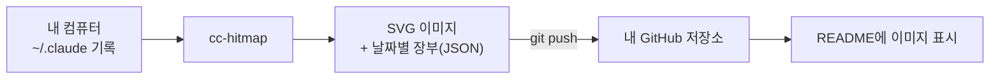

<div align="center">

# 🟧 Claude Code Activity

**내 Claude Code 사용량을 GitHub 잔디처럼, 프로필 README에.**

토큰 · 프롬프트 · 프로젝트를 연도별 잔디로 보여주는 이미지를 만들어 README에 넣는 방법을 안내합니다.

<br>


<sub>↑ 예시 데이터로 만든 이미지입니다 · 실제 사용 모습: <a href="https://github.com/amuldi/Hello-World">amuldi/Hello-World</a></sub>

<br>

[**빠른 시작**](#-빠른-시작) · [**어떻게 나오나**](#-어떻게-나오나) · [**README에 넣기**](#-readme에-넣기) · [**자동 갱신**](#-자동-갱신) · [**옵션**](#-옵션) · [**FAQ**](#-faq)

</div>

<br>

> [!NOTE]
> 이 저장소는 **가이드**입니다. 제 기록은 올라와 있지 않고, 위 이미지도 예시용 가짜 데이터예요.
> 각자 자기 컴퓨터에서 실행해 **자기 저장소**에 올리면 됩니다. 이미지를 만드는 도구는 [ClaudeCode_HitMap](https://github.com/amuldi/ClaudeCode_HitMap)입니다.

## ✨ 어떻게 나오나

<table>
<tr>
<td width="50%" valign="top">

### 🟧 토큰 잔디
하루에 Claude Code가 처리한 토큰 (입력·출력·캐시 포함). 진할수록 많이 쓴 날이에요.

</td>
<td width="50%" valign="top">

### 🟧 프롬프트 잔디
하루에 Claude Code에 보낸 프롬프트 수. 과거 몇 달치도 바로 채워져요.

</td>
</tr>
</table>


### 📊 프로젝트 막대

가장 많이 작업한 프로젝트 폴더 순서예요.


### 🎨 그 밖에

- **연도별**로 따로 만들어져요 (`2026`, `2027`, …)
- 보는 사람의 **라이트/다크 모드를 자동으로** 따라가요
- 한글 표기도 돼요 (`--lang ko`)


## 🚀 빠른 시작

**준비물:** Node 18.17 이상 · git · Claude Code를 써 본 컴퓨터 · 이미지를 올릴 GitHub 저장소 (프로필 저장소 `<내아이디>/<내아이디>`가 가장 간단해요)



### 1️⃣ 설치

```bash
npm install -g github:amuldi/ClaudeCode_HitMap
```

### 2️⃣ 내 저장소에서 실행

```bash
git clone https://github.com/<내아이디>/<내아이디>
cd <내아이디>
cc-hitmap --out claude-activity --prompts --years --push
```

실행하면 이런 결과가 나와요.

```text
History: 2407 prompts on 170 days, 8 projects.
Years: 2026
Scanned 20 transcripts.
Ledger: 170 days (.../claude-activity/claude-hitmap.json)
Last 365 days: 2.8B total tokens · 170 active days · longest streak 13
Pushed.
```

`claude-activity/` 폴더에 파일이 만들어지고, `--push`가 커밋·푸시까지 해 줘요.

| 파일 | 내용 |
|---|---|
| `claude-hitmap-2026.svg` | 2026년 토큰 잔디 |
| `claude-prompts-2026.svg` | 2026년 프롬프트 잔디 |
| `claude-projects.svg` | 프로젝트별 막대 |
| `claude-hitmap.json` | 날짜별 숫자 장부 — **지우지 마세요** |

새 해가 되면 `claude-hitmap-2027.svg`처럼 그 해 파일이 자동으로 생겨요.

### 3️⃣ README에 넣기

저장소 안의 파일이라 **상대 경로**로 넣으면 돼요.

````markdown
## 🤖 Claude Code Activity


````

가운데 정렬은 HTML로 감싸요.

```html
<div align="center">
  
</div>
```

여러 해를 접었다 펼 수 있게 하려면:

````markdown
<details>
<summary><b>2026</b></summary>


</details>
````

## 🔄 자동 갱신

새 활동을 반영하려면 **같은 명령을 다시 실행**하면 돼요.

```bash
cd <내아이디>
cc-hitmap --out claude-activity --prompts --years --push
```

세션이 끝날 때마다 자동으로 하려면 `~/.claude/settings.json`에 훅을 추가하세요.

```json
{
  "hooks": {
    "SessionEnd": [
      {
        "hooks": [
          { "type": "command", "command": "cd ~/code/<내아이디> && cc-hitmap --out claude-activity --prompts --years --push >/dev/null 2>&1 &" }
        ]
      }
    ]
  }
}
```

하루에 한 번이면 충분하다면 cron도 돼요.

```cron
0 23 * * *  cd ~/code/<내아이디> && cc-hitmap --out claude-activity --prompts --years --push
```

## ⚙️ 옵션

| 옵션 | 설명 |
|---|---|
| `--years` | 달력 연도별 잔디를 그려요 (이 가이드의 기본) |
| `--prompts` | 프롬프트 잔디와 프로젝트 막대도 그려요 |
| `--top 12` | 프로젝트 막대에 12개까지 (기본 8) |
| `--lang ko` | 한글로 표기해요 |
| `--metric output` | 출력 토큰만 세요 (`total` · `output` · `input`) |
| `--theme dark` | 다크 모드로 고정해요 (기본은 자동) |
| `--no-mascot` | 마스코트를 빼요 |
| `--tz Asia/Seoul` | 하루를 자르는 시간대 |
| `--push` | 만든 파일을 git에 커밋·푸시해요 |

전체 옵션과 집계 방식은 [ClaudeCode_HitMap 문서](https://github.com/amuldi/ClaudeCode_HitMap)에 있어요.

## ❓ FAQ

<details>
<summary><b>왜 URL만 넣으면 안 되고 직접 실행해야 하나요?</b></summary>

Claude Code의 사용 기록은 서버가 아니라 **내 컴퓨터(`~/.claude`)에만** 있어요. 그래서 내 컴퓨터에서 한 번 세어 이미지를 만들고, 내 저장소에 올려서 README가 그 이미지를 가리키게 해요.

</details>

<details>
<summary><b>설치하기 전 기록도 나오나요?</b></summary>

- **프롬프트 기록**은 오래 남아 있어서 과거 몇 달치가 바로 나와요.
- **토큰 기록**은 Claude Code가 대화 기록을 **30일 뒤에 지워서**, 설치 전 30일보다 오래된 날은 되살릴 수 없어요. 한 번 세어 둔 날은 장부(`claude-hitmap.json`)에 남아 사라지지 않아요.

</details>

<details>
<summary><b>개인정보는 괜찮나요?</b></summary>

저장소에는 **날짜별 숫자**와 **프로젝트 폴더 이름**만 올라가요. 프롬프트 내용과 코드는 읽지도 올리지도 않아요. 프로젝트 이름을 공개하고 싶지 않다면 `--prompts` 없이 실행하세요. 프로젝트 막대와 프롬프트 잔디가 빠져요.

</details>

<details>
<summary><b>컴퓨터가 여러 대예요</b></summary>

각 컴퓨터가 별도의 장부를 만들어요. 합치는 기능은 아직 없어요.

</details>

<details>
<summary><b>claude.ai 웹·앱 대화도 포함되나요?</b></summary>

아니요. Claude Code(터미널·IDE)의 기록만 세요.

</details>

---

<div align="center">
<sub>비공식 도구이며 Anthropic과 관련이 없습니다 · <a href="https://github.com/amuldi/ClaudeCode_HitMap">ClaudeCode_HitMap</a> · MIT</sub>
</div>
