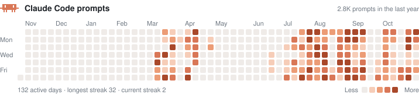
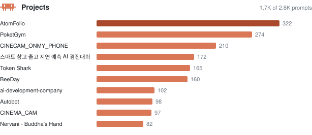
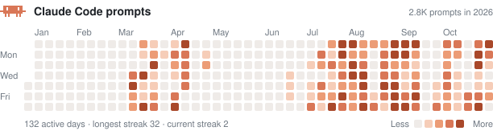

# My Claude Code activity

내가 Claude Code로 얼마나, 무엇을 작업했는지 보여주는 GitHub 잔디 스타일 대시보드입니다.
[ClaudeCode_HitMap](https://github.com/amuldi/ClaudeCode_HitMap)이 내 컴퓨터의 Claude Code 기록을 세어 이 저장소의 이미지를 갱신합니다.

## 토큰 사용량

하루에 Claude Code가 처리한 토큰(입력·출력·캐시 포함)입니다. 진할수록 많이 쓴 날입니다.


> Claude Code는 대화 기록을 30일 뒤에 지웁니다. 그래서 토큰 기록은 10월 초부터만 남아 있고, 그 이후로는 `claude-hitmap.json`에 날짜별로 쌓아 두어 지워져도 사라지지 않습니다.

## 프롬프트 수 (전체 기간)

내가 Claude Code에 보낸 프롬프트 수입니다. 프롬프트 기록은 더 오래 남아 있어서 3월부터 전체가 보입니다.



## 작업한 프로젝트

프롬프트를 가장 많이 보낸 프로젝트 폴더입니다.



## 연도별로 보기

GitHub처럼 달력 연도(1월 1일~12월 31일)마다 따로 봅니다. 새 해가 되면 그 해 이미지가 자동으로 추가됩니다.

<details open>
<summary><b>2026</b></summary>





</details>

## 내 잔디 만들기

내 컴퓨터에서 한 번 실행하면 됩니다. 필요한 것은 Node 18.17 이상과 Claude Code를 쓴 기록(`~/.claude`)뿐입니다.

```bash
# 1. 설치
npm install -g github:amuldi/ClaudeCode_HitMap

# 2. 이미지를 둘 저장소(이 저장소처럼)를 만들어 clone 한 뒤, 그 폴더에서 실행
cd ~/code/My-Claude-Code-activity
cc-hitmap --prompts --years --push
```

`claude-hitmap.svg`, `claude-prompts.svg`, `claude-projects.svg`, `claude-hitmap.json`이 만들어지고 `--push`가 커밋·푸시까지 합니다.

### README에 넣기

```markdown

```

프로필 README(`<내아이디>/<내아이디>` 저장소)에 넣으면 프로필 첫 화면에 잔디가 뜹니다. 이미지는 보는 사람의 라이트/다크 모드를 자동으로 따라갑니다.

### 자주 쓰는 옵션

| 옵션 | 설명 |
|---|---|
| `--prompts` | 프롬프트 수 잔디와 프로젝트 막대도 그립니다 |
| `--years` | 연도별 이미지(`claude-hitmap-2026.svg` 등)도 그립니다 |
| `--top 12` | 프로젝트 막대에 12개까지 보여줍니다 |
| `--days 120` | 최근 120일만 보여줍니다 (기본 365) |
| `--lang ko` | 한글로 표기합니다 |
| `--metric output` | 출력 토큰만 셉니다 |
| `--theme dark` | 다크 모드로 고정합니다 |
| `--no-mascot` | 마스코트를 뺍니다 |

전체 옵션은 [ClaudeCode_HitMap 문서](https://github.com/amuldi/ClaudeCode_HitMap#옵션)에 있습니다.

### 자동으로 갱신하기

`~/.claude/settings.json`에 훅을 추가하면 Claude Code 세션이 끝날 때마다 이미지가 갱신됩니다.

```json
{
  "hooks": {
    "SessionEnd": [
      {
        "hooks": [
          { "type": "command", "command": "cc-hitmap --out ~/code/My-Claude-Code-activity --prompts --years --push >/dev/null 2>&1 &" }
        ]
      }
    ]
  }
}
```

## 개인정보

저장소에는 날짜별 숫자(토큰·프롬프트 수)와 프로젝트 폴더 이름만 올라갑니다. 프롬프트 내용과 코드는 읽지도 올리지도 않습니다. 프로젝트 이름을 공개하고 싶지 않다면 `--prompts` 없이 실행하세요.
